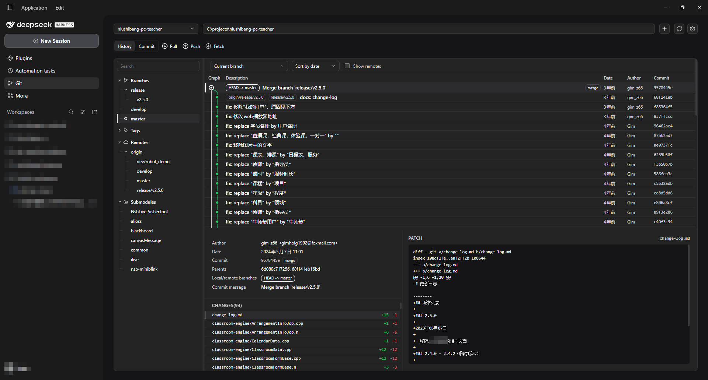
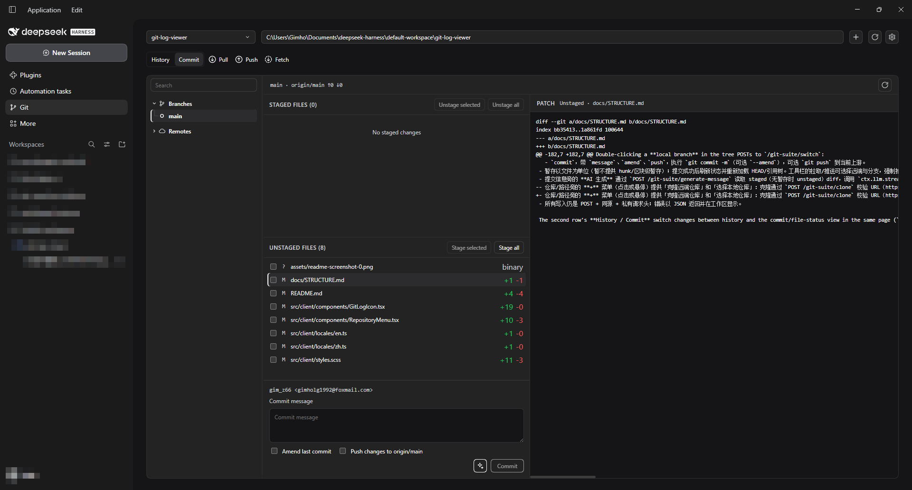

# dsh-git-suite

English | [中文](README.zh.md)

A Git suite plugin for DSH Web: history, branches, the refs tree, commit details, working-tree staging and commits, and branch switching — with amend/push options and more Git operations planned.

## Screenshots

**History**



**Commit and file status**



## Features

- **History**: paged loading, commit graph, commit details, and per-file patches; sticky header, resizable columns, and virtualized rows.
- **Refs tree**: branches, tags, remotes, stashes, and submodules with search; double-click a local branch to switch; open submodules and return to the parent.
- **Working tree and commits**: stage/unstage, per-file diffs, commit or amend, push after committing, and AI-generated commit messages.
- **Remote actions**: the history/commit switch, pull/push/fetch with remote, branch, prune, tag, and force options, and a commit context menu for tag/branch/checkout.
- **Repositories**: the **+** menu clones a remote or selects a local repository; the repository dropdown supports name search.
## Requirements

- DSH Web
- Git available on `PATH`
- Node.js 20+ and pnpm when building from source

## Installation

### From npm (no build)

Install the published **`dsh-git-suite`** bundle through DSH Plugin Manager (or `plugin_manager` `install_bundle` with the package name). The npm package ships the prebuilt `dist/`, so no Node.js, pnpm, or source build is needed.

### From a prebuilt archive

Download the `pnpm pack` / GitHub release tarball (it contains `dist/`), extract it, and add the extracted directory in DSH Plugin Manager (**Plugins → Add plugin**). No build is needed either.

### From source (development)

Clone the repository, build it once, then install the directory as a local bundle through DSH Plugin Manager.

```sh
git clone https://github.com/gimhol/dsh-git-suite.git
cd dsh-git-suite
pnpm install
pnpm build
```

A Gitee mirror is also available:

```sh
git clone https://gitee.com/gimholg/dsh-git-suite.git
cd dsh-git-suite
```

DSH loads built artifacts from `dist/` and never compiles TypeScript; installing a local directory through Plugin Manager does not build it either. `dist/` is a build artifact and is ignored by Git: after cloning, run `pnpm install && pnpm build` above before installing the directory. Rerun `pnpm build` after editing sources.

After changing entry paths in `package.json`, restart DSH (or disable and re-enable the plugin row) so the new entry paths are read.

## Build

```sh
pnpm build         # typecheck + host tsc + client esbuild
pnpm typecheck     # typecheck only
pnpm watch:client  # watch client sources; DSH HMR reloads the bundle
pnpm watch:host    # watch host sources
```

See [docs/STRUCTURE.md](docs/STRUCTURE.md) for how `tsc`, esbuild, and Sass fit together.

## Usage

Open the **Git** icon in the sidebar. Pick a scanned repository, or enter any local Git repository path. Choose a branch and load commits; scrolling near the bottom loads the next page automatically. Set the page size from the **Settings** gear in the header.

The left refs tree switches between branches, tags, remotes, stashes, and submodules; the search box filters refs. Groups with no tags, stashes, or submodules are hidden; submodules sit at the bottom and open their repository on click, with the repository selector showing `[submodule]name` and a **← Parent** button to return to the superproject.

Double-click a local branch in the tree to switch the working tree to it; a switch that would overwrite local changes is rejected.

Click **Commit** in the second row to switch to the commit/file-status view, and **History** to return: check files to stage selected or stage all, unstage staged files, view a file's diff on the right, write a commit message, and commit; amend last commit and push to the upstream are optional.

Click **+** beside the repository/path controls, choose **Clone remote repository** and enter the remote URL and a local destination (which must not exist; **Choose** opens the OS folder chooser for a parent folder and appends the repository name); after cloning, the repository opens in this panel. **Select local repository** opens a dialog where **Choose folder** uses the OS picker (or pick a scanned repository / enter a path); **Open** only opens the repository in this panel. Use DSH's own Workspaces add flow to register a DSH workspace.

The sparkle icon button left of Submit (with a tooltip) fills the message from the changes with the default model; it reports an error when no default model is configured or the working tree has no changes.

Right-click any commit in the log for **Tag / Branch / Checkout**: the tag dialog takes a name and optional message (with a force checkbox); the branch dialog takes a new branch name; the checkout dialog picks a local branch or a detached HEAD, with an explicit warning before confirming.

You can also pick **Git** on the right sidebar's Start page to open the suite as a right-sidebar tab. Set the page size from the **Settings** gear in the header.

## Docs

- [docs/STRUCTURE.md](docs/STRUCTURE.md) — directory layout, module responsibilities, and build pipeline

## Security

Read routes (log, commit detail, working-tree status, diff) only run `git log` / `git show` / `git status` / `git diff`; all other POST routes (branch switch, stage, unstage, commit, pull/push/fetch, remote removal, branch merge/rebase/rename/delete, clone, AI generation, directory picking, tag, branch, checkout) require the same-origin check and the plugin's private request header. A switch accepts local branches only and is never forced; staging uses `git add`, unstaging uses `git reset`, committing uses `git commit` (optionally `--amend`), pull/push take an explicit remote and branch, and push's force mode is used only when **Force push** is checked; the push after committing still targets the configured upstream only. Cloning accepts https / ssh / git / file / absolute local paths only (rejecting `ext::` / `fd::` and other transports that execute local commands); the destination must be absolute, its parent must exist, and it must not already exist; the clone destination can pick its parent with the OS chooser. AI generation only reads `git diff` / `git status` and sends the file list and diff to DSH's configured default model provider; it never writes to the repository. Selecting a local repository opens the OS chooser through DSH's native directory picker (`ctx.directoryPicker`) and only returns the result to the plugin; it does not register a DSH workspace. Tag and branch names pass `git check-ref-format`; tags add `-f` only when **Force an existing tag** is checked; merge/rebase run in the current working tree and return Git errors on conflicts; rename uses `git branch -m` and delete uses `git branch -d`; removing a remote uses `git remote remove`; checkout switches to a local branch or detaches HEAD at a commit, never forces, and returns 409 when the working tree has changes it would overwrite.

## License

MIT © 2026 Gim. See [LICENSE](LICENSE).

