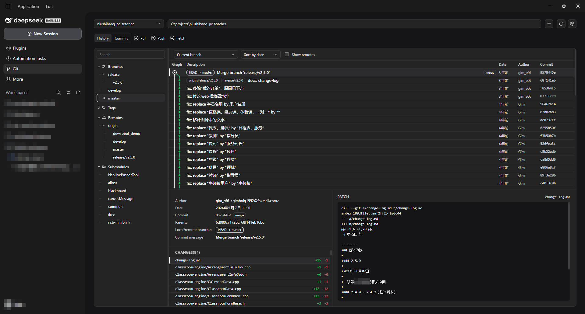

# dsh-git-suite

[English](README.md) | 中文

DSH Web 的 Git 套件插件：提供提交历史、分支、引用树、提交详情、文件状态/暂存/提交与分支切换，支持提交后可选的修改/推送，后续继续扩展更多 Git 操作。

## 截图

**提交历史**



**提交与文件状态**


## 功能

- **提交历史**：分页加载、提交路线图、提交详情与逐文件补丁；表头与列宽可调，虚拟滚动。
- **引用树**：分支、标签、远端、贮藏、子模块，支持搜索；双击本地分支切换工作区；子模块可打开并返回父仓库。
- **提交与文件状态**：暂存/取消暂存、逐文件 diff、提交或修改最后一次提交、提交后推送，以及 AI 生成提交信息。
- **远端操作**：历史/提交切换，拉取/推送/获取（可选远端、分支、prune、标签、强制推送），提交右键标签/分支/检出。
- **仓库**：**+** 菜单克隆远端或选择本地仓库；仓库下拉支持按名字搜索。
## 环境

- DSH Web
- `PATH` 中有 Git
- 从源码构建时需要 Node.js 20+ 与 pnpm

## 安装

### 从 npm 安装（无需编译）

通过 DSH 插件管理器（或 `plugin_manager` 的 `install_bundle`，包名 `dsh-git-suite`）安装已发布的 bundle。npm 包内已带构建好的 `dist/`，用户无需 Node.js、pnpm，也无需从源码编译。

### 从预构建包安装

下载 `pnpm pack` / GitHub Release 的 tarball（内含 `dist/`），解压后把目录添加到 DSH 插件管理器（**Plugins → Add plugin**），同样无需编译。

### 从源码安装（开发）

克隆仓库、构建一次，再通过 DSH 插件管理器把该目录安装为本地 bundle。

```sh
git clone https://github.com/gimhol/dsh-git-suite.git
cd dsh-git-suite
pnpm install
pnpm build
```

也可以从 Gitee 镜像克隆：

```sh
git clone https://gitee.com/gimholg/dsh-git-suite.git
cd dsh-git-suite
```

DSH 只加载构建产物（`dist/`），不会编译 TypeScript；插件管理器安装本地目录时也不会替你构建。`dist/` 是构建产物，已被 Git 忽略：克隆后请先执行上面的 `pnpm install && pnpm build`，再安装该目录。修改源码后重新执行 `pnpm build`。

修改 `package.json` 中的入口后，需要重启 DSH（或在插件页禁用再启用该插件），让新的入口路径生效。

## 构建

```sh
pnpm build         # 类型检查 + 宿主端 tsc + 客户端 esbuild
pnpm typecheck     # 仅类型检查
pnpm watch:client  # 监听客户端源码，DSH HMR 会重新加载产物
pnpm watch:host    # 监听宿主端源码
```

构建管线（`tsc` / `esbuild` / Sass 的分工）见 [docs/STRUCTURE.zh.md](docs/STRUCTURE.zh.md)。

## 使用

点击侧栏的 **Git** 图标，选择已扫描的仓库，或输入任意本地 Git 仓库路径；选择分支并加载提交，滚动到接近底部会自动加载下一页；每页条数在顶栏的 **设置**（齿轮）弹窗中调整。

左侧引用树可以在分支、标签、远端、贮藏和子模块之间切换；搜索框可过滤引用。没有标签、贮藏或子模块时对应分组隐藏；子模块位于最下方，点击打开子模块仓库，仓库选择显示 `[submodule]名称`，并出现「← 父仓库」按钮可返回父仓库。

双击引用树中的本地分支可将工作区切换到该分支；工作区有会被覆盖的改动时操作会被拒绝。

点击第二行的 **提交** 切换到提交/文件状态，点 **历史** 返回提交历史：勾选文件后暂存所选或暂存所有，已暂存文件可取消暂存；点击文件在右侧查看 diff；填写提交信息后点 **提交**，可勾选「修改最后一次提交」或「立即推送变更到上游」。

点击仓库/路径旁的 **+**，选择「克隆远端仓库」填写远端地址和本地目录（目录必须不存在，也可点「选择」用系统目录选择器选父目录并自动追加仓库名），克隆完成后在当前面板打开；选择「选择本地仓库」会打开弹窗，可点「选择目录」用系统选择器选 Git 仓库，也可从已扫描仓库选择或直接输入路径，点「打开」只在当前面板打开仓库。如需加入 DSH 工作区，请使用 DSH 自带的 Workspaces 添加入口。

提交按钮左侧的 AI 图标（悬停提示「AI 生成」）会用默认模型根据改动自动填写提交信息；没有配置默认模型、或工作区没有改动时按钮会报错提示。

在提交列表右键任意提交，可打开「标签 / 分支 / 检出」菜单：标签弹窗填写标签名和可选说明（勾选覆盖同名标签）；分支弹窗填写新分支名；检出弹窗选择本地分支或分离 HEAD，分离 HEAD 会明确警告，确认后才执行。

也可以在右侧栏的「开始」页选择 **Git**，将它作为右侧标签页打开。每页条数在顶栏的 **设置**（齿轮）弹窗中调整。

## 文档

- [docs/STRUCTURE.zh.md](docs/STRUCTURE.zh.md) — 目录布局、模块职责与构建管线

## 安全

读取路由（日志、详情、文件状态、diff）只执行 `git log` / `git show` / `git status` / `git diff`；其余 POST 路由（切换分支、暂存、取消暂存、提交、拉取/推送/获取、删除远端、分支合并/变基/重命名/删除、克隆、AI 生成、选择目录、标签、分支、检出）都要求同源并携带插件的私有请求头。切换分支只接受本地分支、不 force；暂存使用 `git add`，取消暂存使用 `git reset`；提交使用 `git commit`，可 `--amend`；拉取/推送可指定远端与分支；推送的强制模式只在明确勾选「强制推送」时使用；提交后的推送仍只推送到已配置的上游。克隆只接受 https / ssh / git / file / 绝对本地路径（拒绝 `ext::` / `fd::` 等执行本地命令的传输），目标必须是绝对路径、父目录存在且目标不存在；克隆目标可用系统目录选择器选择父目录。AI 生成只执行 `git diff` / `git status` 读取改动，将文件列表与 diff 发送给 DSH 配置的默认模型提供方，不写入仓库。选择本地仓库通过 DSH 的原生目录选择器（`ctx.directoryPicker`）打开系统对话框，只把结果返回给插件，不注册 DSH 工作区。标签/分支名都经 `git check-ref-format` 校验；标签只有勾选「覆盖同名标签」时才加 `-f`；分支合并/变基在当前工作区执行，冲突时返回 Git 错误；重命名使用 `git branch -m`，删除使用 `git branch -d`；删除远端使用 `git remote remove`；检出支持本地分支或提交哈希 `git switch --detach`，不 force，工作区有会被覆盖的改动时返回 409。

## 许可证

MIT © 2026 Gim。详见 [LICENSE](LICENSE)。

