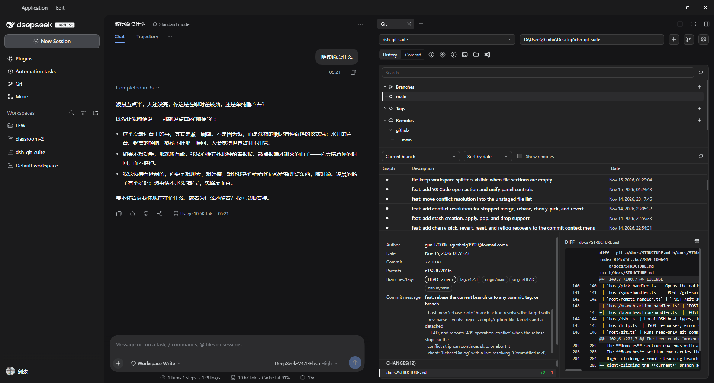
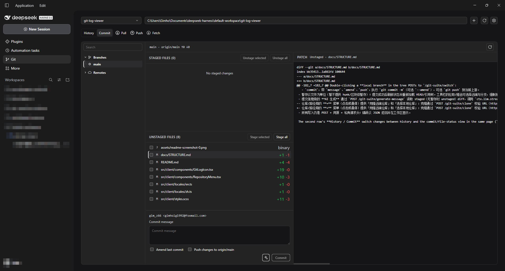
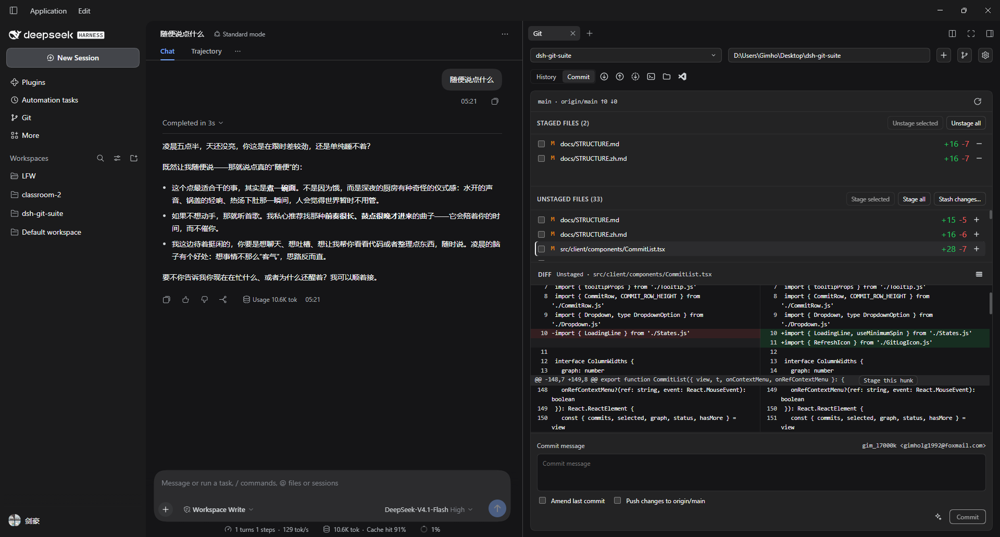

# dsh-git-suite

[English](README.md) | 中文

DSH Web 的 Git 套件插件：提供提交历史、分支、引用树、提交详情、文件状态/暂存/提交与分支切换，支持提交后可选的修改/推送，后续继续扩展更多 Git 操作。

## 截图

**提交历史**


**提交详情与差异**



**提交与文件状态**



**按块暂存与分栏差异**



## 使用

- **在哪里打开**：左侧栏的 **Git** 入口、右侧面板开始页的 **Git** 卡片，或在任意位置按 **Ctrl/Cmd+Shift+G**（可在 DSH 的键盘快捷键设置里改）。两处是同一个面板。
- **选仓库**：用项目下拉（可输入过滤）或旁边的 **+** 菜单**克隆远端**/**选择本地**仓库；右侧面板默认打开当前会话所在仓库。
- **两个视图**：第二行的 **历史 / 提交** 切换。历史显示提交路线图与详情，提交显示工作区。
- **提交**：整文件用行尾按钮暂存、单个块用 **暂存此块**、拖动选中行后在右键菜单里暂存；写提交信息（↑ 可回溯本仓库历史信息）后点 **提交**。可选 **修改最后一次提交** 与 **提交后推送**。
- **差异**：每个差异都能在统一视图与分栏视图之间切换。
- **其它操作**：右键分支、标签、贮藏、远端、提交、文件都有对应菜单（检出、合并、变基、拣选、重置、贮藏、打标签……）；右上角按钮可在命令行、文件管理器或 VS Code 中打开仓库。

## 功能

- **提交历史**：分页加载、提交路线图、提交详情与逐文件差异（统一视图或左右分栏）；表头与列宽可调，虚拟滚动。
- **引用树**：分支、标签、远端、贮藏、子模块，支持搜索；双击本地分支切换工作区；子模块可打开并返回父仓库。
- **提交与文件状态**：整文件、单个 hunk 或拖动选中行的暂存/取消暂存，查看差异，提交或修改最后一次提交，提交后推送，以及 AI 生成提交信息。
- **远端操作**：历史/提交切换，拉取/推送/获取（可选远端、分支、prune、标签、强制推送），合并/变基、变基到任意提交，提交右键标签/分支/检出/拣选/反向提交/重置。
- **右侧面板**：同一面板可在 DSH 右侧面板打开（Ctrl/Cmd+Shift+G），默认打开当前会话所在仓库，并按仓库分别记住视图、筛选、分栏尺寸与草稿。
- **仓库**：**+** 菜单克隆远端或选择本地仓库；仓库下拉支持按名字搜索。
## 环境

- DSH Web
- `PATH` 中有 Git
- 从源码构建时需要 Node.js 20+ 与 pnpm

## 安装

### 从 npm 安装（无需编译）

通过 DSH 插件管理器（或 `plugin_manager` 的 `install_bundle`，包名 `dsh-git-suite`）安装已发布的 bundle。npm 包内已带构建好的 `dist/`，用户无需 Node.js、pnpm，也无需从源码编译。

### 从预构建包安装

下载 `pnpm pack` / GitHub Release 的 tarball（内含 `dist/`），解压后把目录添加到 DSH 插件管理器（**Plugins → Add plugin**），同样无需编译。

### 从源码安装（开发）

克隆仓库、构建一次，再通过 DSH 插件管理器把该目录安装为本地 bundle。

```sh
git clone https://github.com/gimhol/dsh-git-suite.git
cd dsh-git-suite
pnpm install
pnpm build
```

也可以从 Gitee 镜像克隆：

```sh
git clone https://gitee.com/gimholg/dsh-git-suite.git
cd dsh-git-suite
```

DSH 只加载构建产物（`dist/`），不会编译 TypeScript；插件管理器安装本地目录时也不会替你构建。`dist/` 是构建产物，已被 Git 忽略：克隆后请先执行上面的 `pnpm install && pnpm build`，再安装该目录。修改源码后重新执行 `pnpm build`。

修改 `package.json` 中的入口后，需要重启 DSH（或在插件页禁用再启用该插件），让新的入口路径生效。

## 构建

```sh
pnpm build         # 类型检查 + 宿主端 tsc + 客户端 esbuild
pnpm typecheck     # 仅类型检查
pnpm watch:client  # 监听客户端源码，DSH HMR 会重新加载产物
pnpm watch:host    # 监听宿主端源码
```

构建管线（`tsc` / `esbuild` / Sass 的分工）见 [docs/STRUCTURE.zh.md](docs/STRUCTURE.zh.md)。


## 文档

- [docs/STRUCTURE.zh.md](docs/STRUCTURE.zh.md) — 目录布局、模块职责与构建管线


## 许可证

MIT © 2026 Gim。详见 [LICENSE](LICENSE)。


